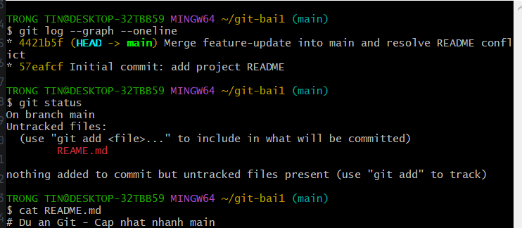

# Báo cáo Bài 2: Quản lý nhánh và giải quyết xung đột

1. Đổi tên nhánh master thành main.
2. Tạo nhánh feature-update và sửa dòng tiêu đề README.md, sau đó commit.
3. Quay về main, sửa cùng dòng tiêu đề thành nội dung khác và commit.
4. Chạy git merge feature-update, xảy ra xung đột tại README.md.
5. Mở README.md bằng Notepad, kết hợp nội dung của hai nhánh
   và xóa các dấu <<<<<<<, =======, >>>>>>>.
6. Lưu tệp, chạy git add README.md và git commit để hoàn thành merge.
7. Kiểm tra bằng git log --graph --oneline và git status.

Merge commit có hai commit cha. Git thực hiện 3-Way Merge dựa trên
bản gốc chung và hai phiên bản trên main, feature-update.

